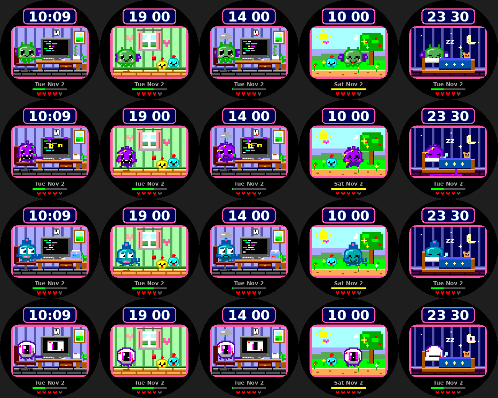
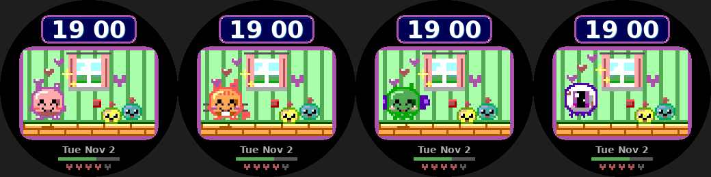
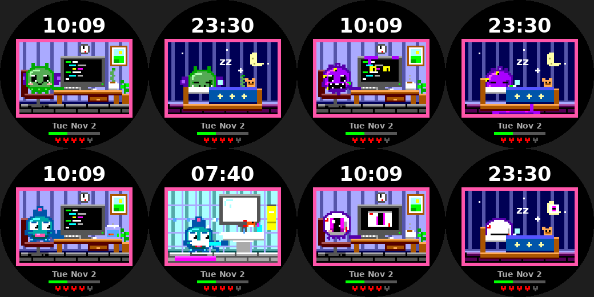

# watchfaces

Watchfaces for the Pebble Round 2 (`gabbro` platform, 260x260 round color).

## neon-grid

A cyberpunk watchface: glitchy RGB-split time over a rain-soaked neon skyline, with step and battery bars and three colour themes (flick your wrist to switch). See [`neon-grid/`](neon-grid/README.md).

## desk-pet

A virtual-pet-style watchface where a little pet whose activity follows the time of day.

| Time | Weekdays | Weekends |
|---|---|---|
| 22:00-07:00 | Sleeping (moon, stars, floating z's) | same |
| 07:00-07:30 | Waking up and stretching | same |
| 07:30-08:00 | Brushing teeth | same |
| 08:00 | Walking to work (office, car, bus stop) | Breakfast |
| 09:00-17:00 | Coding at a desk, video-call meetings at :00-:30 of 11 and 15, lunch at 12 | Park walk with a kid (9-12), lunch, TV (13-15), gaming (15-17) |
| 17:00 | Walking home (sunset sky) | Playing with the kids |
| 18:00 | Family dinner | Family dinner |
| 19:00 | Playing ball with the kids | Playing with the kids |
| 20:00 | Bedtime story: reading to the kids, who fall asleep at :30 | same |
| 21:00 | Reading in bed | same |

Colours are softened through one palette map (`tools/gen_palette.py`, applied to every draw call) and the preview tool takes its colours straight from the SDK header, so renders match the watch's real palette. The time sits in a mauve-framed navy display with rivets, a drop-shadowed numeral and a blinking colon. The scene is a 64x42 pixel grid (16x16 pet sprites with outlines, shading and glossy eyes; textured wallpaper and wood floors; beveled furniture; pet shadows). Battery is shown as 5 hearts. A green step bar fills toward 8,000 steps (gold when reached); the pet frowns and cries if you fall well behind pace after 11:00, and smiles once the goal is hit. All art is drawn with rectangles (no image assets).

### Build

```sh
uv tool install pebble-tool
pebble sdk install latest
cd desk-pet
pebble build
pebble install --emulator gabbro
```

### Pets

Nine pets: blob (pink), cat (orange tabby with whiskers and a wagging tail), bunny, bear and frog, plus four cute Lovecraftian ones: baby Cthulhu (flapping bat wings, wiggly tentacle beard), shoggoth (purple goo with too many blinking eyes), deep one (teal fish-person with crest, gills and tail fin) and the great eye (a floating eyeball with a shiny iris and dangling tendrils). **Flick your wrist once to pet your pet** (it hops and hearts float up), and **flick twice within two seconds to switch pet**; the choice is saved.




Tap reaction (hearts and a happy hop):



Columns: coding, play, sad at the desk, happy on a walk, asleep.

**Eldritch scene quirks** (only for those pets): Cthulhu has a tentacle curling out of the coffee mug and waving from the blanket; the Shoggoth grows eyes on the monitor and leaves a goo puddle under the bed; the Deep One keeps a goldfish bowl on the desk and a fish leaps out of the bathroom sink; the Great Eye watches from the monitor and the moon.


 Rows (eldritch): cthulhu, shoggoth, deep one, great eye.

### Status

- `pebble build` succeeds for `gabbro` against SDK 4.33.1 (no code warnings).
- The Pebble emulator (QEMU + pypkjs) boots the gabbro firmware in the cloud sandbox but never answers the protocol, so the face has **not** been run in the real emulator or on a watch.
- `desk-pet/tools/preview/render.py` compiles the real `main.c` against a stub Pebble API and draws every scene to PNG (stand-in font, no firmware). Output: `desk-pet/docs/preview.png`.

```sh
python3 desk-pet/tools/preview/render.py /tmp/preview   # needs gcc + Pillow
```


