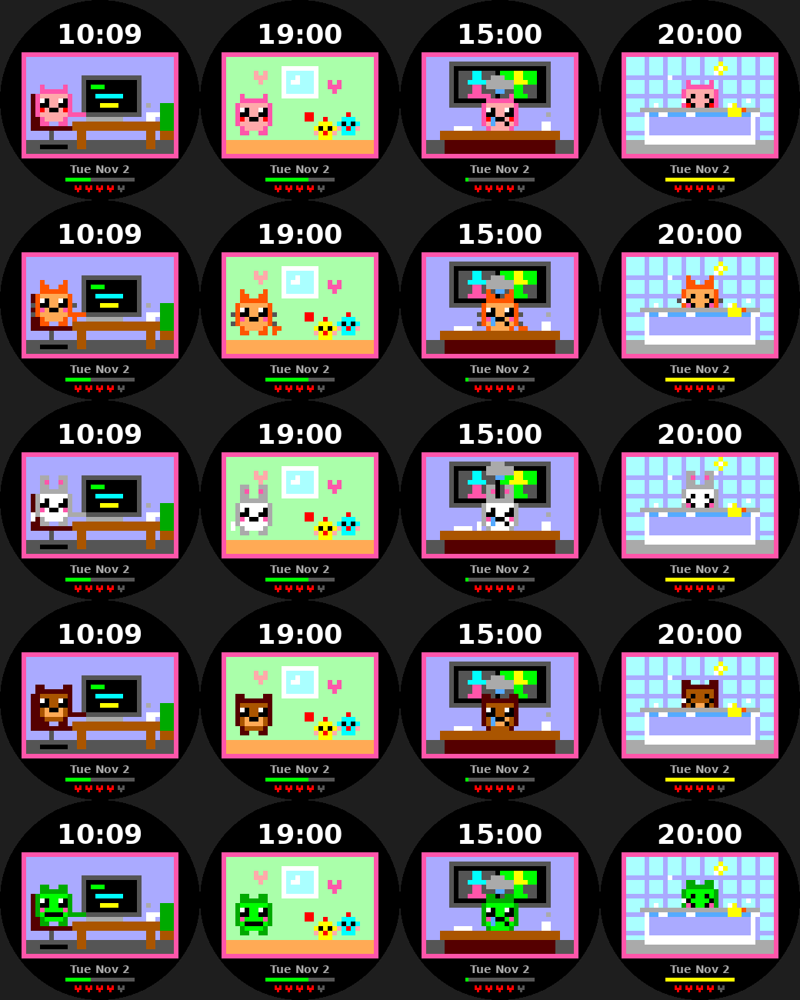
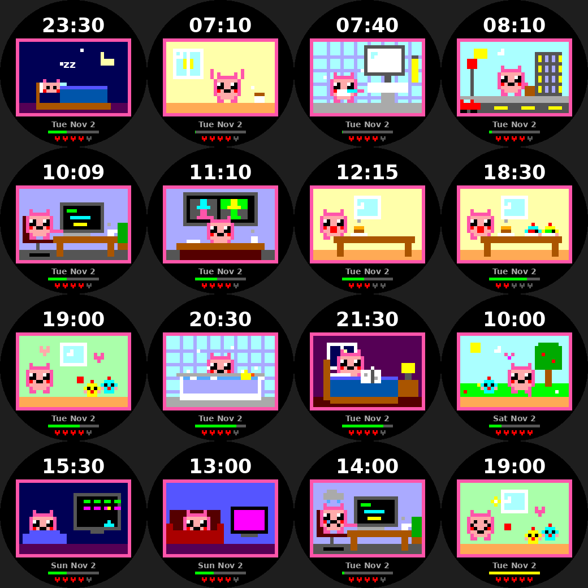

# watchfaces

Watchfaces for the Pebble Round 2 (`gabbro` platform, 260x260 round color).

## desk-pet

A Tamagotchi-style pet whose activity follows the time of day.

| Time | Weekdays | Weekends |
|---|---|---|
| 22:00-07:00 | Sleeping (moon, stars, floating z's) | same |
| 07:00-07:30 | Waking up and stretching | same |
| 07:30-08:00 | Brushing teeth | same |
| 08:00 | Walking to work (office, car, bus stop) | Breakfast |
| 09:00-17:00 | Coding at a desk, video-call meetings at :00-:30 of 11 and 15, lunch at 12 | Park walk with a kid (9-12), lunch, TV (13-15), gaming (15-17) |
| 17:00 | Walking home (sunset sky) | Playing with the kids |
| 18:00 | Family dinner | Family dinner |
| 19:00 | Playing ball with the kids | Playing with the kids |
| 20:00 | Bath with a rubber duck | same |
| 21:00 | Reading in bed | same |

Battery is shown as 5 hearts. A green step bar fills toward 8,000 steps (gold when reached); the pet frowns and cries if you fall well behind pace after 11:00, and smiles once the goal is hit. All art is drawn with rectangles (no image assets).

### Build

```sh
uv tool install pebble-tool
pebble sdk install latest
cd desk-pet
pebble build
pebble install --emulator gabbro
```

### Pets

Five pets: blob (pink), cat (orange tabby with whiskers and a wagging tail), bunny, bear and frog. **Flick your wrist (tap) to switch pet**; the choice is saved. Rows below are blob, cat, bunny, bear, frog.



### Status

- `pebble build` succeeds for `gabbro` against SDK 4.33.1 (no code warnings).
- The Pebble emulator (QEMU + pypkjs) boots the gabbro firmware in the cloud sandbox but never answers the protocol, so the face has **not** been run in the real emulator or on a watch.
- `desk-pet/tools/preview/render.py` compiles the real `main.c` against a stub Pebble API and draws every scene to PNG (stand-in font, no firmware). Output: `desk-pet/docs/preview.png`.

```sh
python3 desk-pet/tools/preview/render.py /tmp/preview   # needs gcc + Pillow
```


