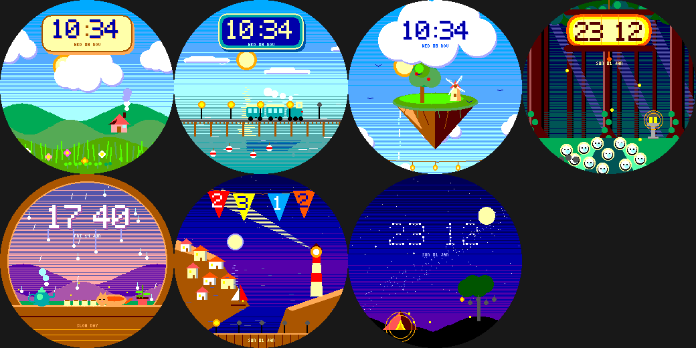

# ghibli: chill, hand-painted watchfaces

Gentle, painterly Pebble Round 2 faces inspired by the *mood* of classic hand-drawn pastoral animation: towering
cumulus, rolling green hills, golden light, sleepy night skies. Everything is **original art**: no characters,
logos or scenes from any film. They share `../lab/common/face.h` and `paint.h` (dithered sky gradients, shaded
clouds, hill layers) and the lab's preview and sanity-check tools.

| Face | Scene |
|---|---|
| [`meadow`](meadow) | Day-cycle meadow with cottage, drifting clouds, sun/moon on the real time, flowers for steps |
| [`tiderail`](tiderail) | Calm sea with a little steam train crossing a causeway (train = minute hand), buoys for steps |
| [`skyisle`](skyisle) | Floating island with a windmill, tree and waterfall; time on a cloud, birds for steps, lanterns for battery |
| [`lanternwood`](lanternwood) | Komorebi forest: light shafts, stone lantern, one forest spirit per hour, fireflies for steps, time on a paper lantern |
| [`rainwindow`](rainwindow) | Rainy window: time in condensation, steaming teapot, battery teacups, sleepy cat, plant growing per 1,000 steps |
| [`harbor`](harbor) | Seaside cliff town with a sweeping lighthouse beam, sailboats per 2,000 steps, time on bunting flags |
| [`hilltop`](hilltop) | Starry hilltop: time as a constellation, real moon phase, shooting star each minute, tent and lantern tree |

## Shared pieces

- `../lab/common/face.h` - time/steps/battery state, low-power ticking, the wrist-tap hook, and the exact pixel
  toolkit; `../lab/common/paint.h` - painterly helpers: scanline-dithered sky gradients, shaded cumulus clouds, sine
  hill layers, soft plates, a translucent-beam triangle, the day-cycle sky palette (night / dawn / day / golden hour /
  dusk) and chunky 5x7 digits.
- Each scene follows the **real time of day**, shows the time legibly in a way that suits the scene (cream plate,
  station board, cloud, paper lantern, condensation, bunting flags), turns **steps** into something that grows
  (flowers, buoys, birds, fireflies, plant leaves, sailboats) and **battery** into something that glows (sprouts,
  lamps, lanterns, mushrooms, teacups). Every one has a wrist-tap mode.
- `release/` - a prebuilt `.pbw` for each scene (SDK 4.33.1, ~13 KB each) and `ghibli-faces.zip`.

## Status / caveats

Every face builds for `gabbro` and passes an AddressSanitizer/UBSan sweep. **None has been run on the emulator or a
real watch**, so animation timing, tap behaviour and per-frame cost are untested (draw-call counts per frame are about
800-3,100, see `../lab/tools/stats.py`). The art is original: no characters, logos or scenes from any film, and the
names avoid any studio or film titles. Before publishing, give each a store title and description of your own.
