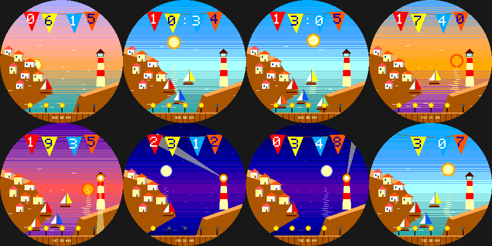

# Harbor Light

A whitewashed seaside town on a cliff above a sparkling harbour, for the Pebble Round 2 (`gabbro`). Original art in
the spirit of gentle pastoral animation.

- **A lighthouse beam sweeps once a minute after dusk** (it is the second hand); houses light their windows at dusk.
- **Sailboats rock in the harbour: one always, plus one for every 2,000 steps** (up to 5).
- The sky and sea follow the **real time of day**; the sun or moon glitters on the water; gulls fly by day.
- **The time is on a string of bunting flags, one digit per pennant.** Battery is five lamps along the quay.
- **Wrist tap:** bright / soft beam, and more / less flag flutter.

Build: `pebble build` (uses `../../lab/common/face.h` and `paint.h`). Previews: `python3 preview.py OUTDIR`.
Status: builds for `gabbro`; passes an AddressSanitizer/UBSan sweep; **not run on the emulator or a real watch**.
