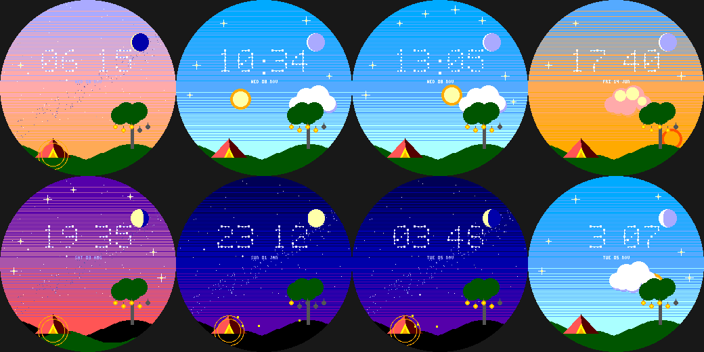

# Hilltop Stars

A quiet hilltop under an enormous sky, for the Pebble Round 2 (`gabbro`). Original art in the spirit of gentle
pastoral animation.

- **The time is a constellation:** each digit is a pattern of stars joined by faint lines.
- Twinkling stars and a Milky Way fade in as it gets dark; **the Moon is shown in its real phase**; a **shooting star**
  streaks across a few seconds into every minute; the sky follows the real time of day (a sun on its arc by day).
- A lone tree with **five hanging lanterns (battery)** and a little tent with a glowing doorway; fireflies at night.
- **One bright four-point sparkle appears in the sky for every 1,000 steps** (up to 8).
- **Wrist tap:** show / hide the constellation lines.

Build: `pebble build` (uses `../../lab/common/face.h` and `paint.h`). Previews: `python3 preview.py OUTDIR`.
Status: builds for `gabbro`; passes an AddressSanitizer/UBSan sweep; **not run on the emulator or a real watch**.
