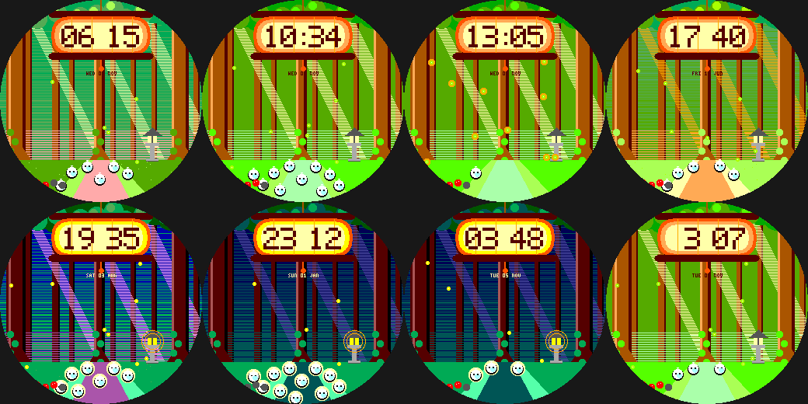

# Lantern Forest

A hushed forest of light shafts (komorebi) for the Pebble Round 2 (`gabbro`). Original art in the spirit of gentle
pastoral animation.

- Layered trunks with roots and moss, a leafy canopy, a mossy path and a stone lantern that glows at dusk and night.
  Dithered **light shafts** are golden by day and pale blue moonbeams at night; the whole palette follows the real time of day.
- **Little round forest spirits sit along the path, one for every hour on the clock (1-12)**, blinking now and then.
- **Fireflies** drift about (five, plus one per 1,000 steps) and wink out now and then.
- The time glows on a **hanging paper lantern**; battery is five little mushrooms.
- **Wrist tap:** fireflies glow brighter / softer.

Build: `pebble build` (uses `../../lab/common/face.h` and `paint.h`). Previews: `python3 preview.py OUTDIR`.
Status: builds for `gabbro`; passes an AddressSanitizer/UBSan sweep; **not run on the emulator or a real watch**.
