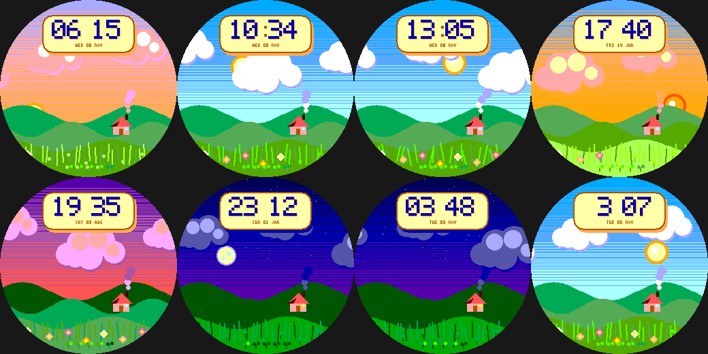

# Soft Meadow

A chill, hand-painted pastoral day-cycle for the Pebble Round 2 (`gabbro`). Original art in the spirit of gentle
pastoral animation (no characters, logos or scenes from any film).

- The sky blends through **night, dawn, day, golden hour and dusk** with scanline-dithered gradients; the **sun and
  moon cross the sky with the real time** and tuck behind the hills at the horizon.
- Shaded cumulus clouds drift slowly; a cottage's chimney smoke curls; tall grass sways; the cottage window glows at night.
- **A flower blooms for every 1,000 steps** (up to 8); battery shows as five sprouts.
- Time on a soft cream plate with an offset shadow, 12h/24h aware. **Wrist tap:** calm <-> breezy (more sway).

Build: `pebble build` (uses `../../lab/common/face.h` and `paint.h`). Previews: `python3 preview.py OUTDIR`.
Status: builds for `gabbro`; passes an AddressSanitizer/UBSan sweep; **not run on the emulator or a real watch**.
