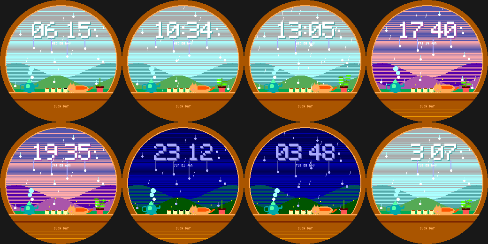

# Rainy Window

A cosy, drowsy moment for the Pebble Round 2 (`gabbro`). Original art in the spirit of gentle pastoral animation.

- You are indoors looking out through a **rain-streaked window** at soft misty hills; the light follows the real
  time of day (grey day, warm pink evening, deep blue night with a few lit windows).
- **The time is written in condensation on the glass**, with little trails of water running down from each digit,
  droplets sliding down the pane and slanted rain falling.
- On the sill: a **steaming teapot**, **five teacups (battery = tea left)**, a **sleepy cat that breathes**, and a
  **potted plant that grows a leaf for every 1,000 steps** (up to 8).
- **Wrist tap:** light rain <-> downpour.

Build: `pebble build` (uses `../../lab/common/face.h` and `paint.h`). Previews: `python3 preview.py OUTDIR`.
Status: builds for `gabbro`; passes an AddressSanitizer/UBSan sweep; **not run on the emulator or a real watch**.
