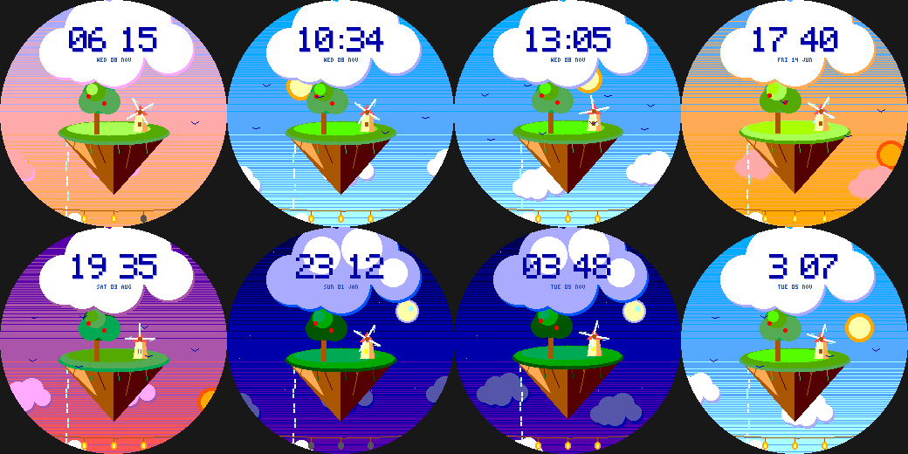

# Sky Isle

A little island drifting in the clouds, for the Pebble Round 2 (`gabbro`). Original art in the spirit of gentle
pastoral animation.

- The island **bobs gently**; a lone tree sways; a small **windmill turns with the seconds**; a waterfall trickles into a mist;
  parallax clouds drift. The sky follows the **real time of day** (sun by day, moon and stars by night).
- **The time is written on a big soft cloud.** One bird joins the flock for **every 1,000 steps** (up to 8);
  **battery = five hanging lanterns**.
- **Wrist tap:** breezy (faster windmill and clouds) <-> still.

Build: `pebble build` (uses `../../lab/common/face.h` and `paint.h`). Previews: `python3 preview.py OUTDIR`.
Status: builds for `gabbro`; passes an AddressSanitizer/UBSan sweep; **not run on the emulator or a real watch**.
