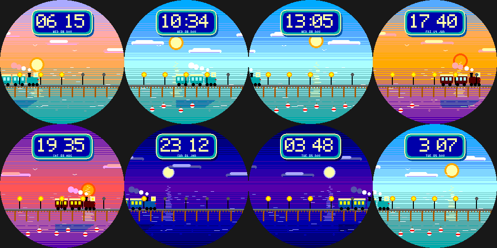

# Tide Rail

A calm, shallow sea and a little steam train crossing a causeway, for the Pebble Round 2 (`gabbro`). Original art in
the spirit of gentle pastoral animation.

- **The train is the minute hand:** it creeps across the sea once an hour (coaches' windows glow from golden hour on).
- The sky follows the **real time of day**; the sun or moon throws a glittering path on the water; low clouds and gulls drift by.
- **Causeway lamps = battery** (five lamps); **a buoy floats up for every 1,000 steps** (up to 8).
- The hour:minute time is on a little station board. **Wrist tap:** calm sea <-> choppy sea.

Build: `pebble build` (uses `../../lab/common/face.h` and `paint.h`). Previews: `python3 preview.py OUTDIR`.
Status: builds for `gabbro`; passes an AddressSanitizer/UBSan sweep; **not run on the emulator or a real watch**.
