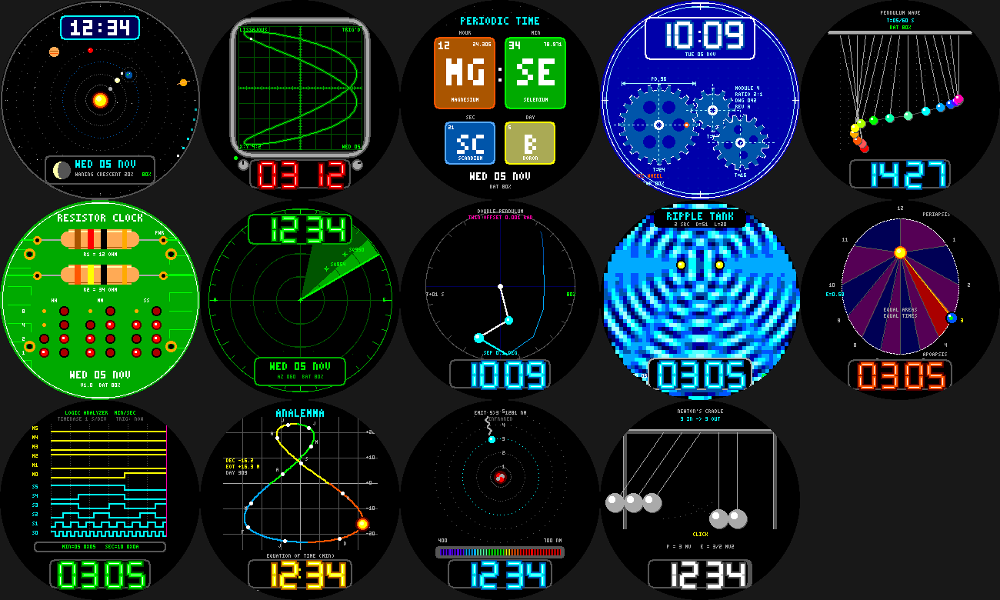

# lab: physics & engineering watchfaces

Fourteen Pebble Round 2 (`gabbro`, 260x260) watchfaces that share one framework. Each is its own Pebble
project (own UUID, `pebble build`), but they all `#include "../../../common/face.h"`.

| Face | Idea | Wrist tap |
|---|---|---|
| [`orrery`](orrery) | Planets at their approximate real positions today, Moon in its real phase | whole system / inner planets |
| [`scope`](scope) | Phosphor oscilloscope: Lissajous figure set by the time, LED readout | Lissajous / Fourier square wave (Gibbs) |
| [`elements`](elements) | Hour / minute / seconds / day as periodic-table element tiles | seconds / steps element |
| [`gears`](gears) | Meshing spur gears with correct ratios and tooth phasing, blueprint look | blueprint / brass |
| [`pendulum`](pendulum) | 15-pendulum wave that realigns every 60 s | motion-trail ghosts |
| [`resistor`](resistor) | Hour & minute as resistor colour bands, BCD LED matrix | LED colour |
| [`radar`](radar) | ATC scope with a sweep, phosphor wedge and drifting targets | green / amber / ice |
| [`chaos`](chaos) | Double pendulum + a 0.001 rad twin: the butterfly effect | twin / art trail |
| [`ripple`](ripple) | Wave interference from 2-4 point sources | 2 / 3 / 4 sources |
| [`kepler`](kepler) | The hour hand is a planet on a Kepler orbit; equal areas in equal times | eccentricity 0.5 / 0.7 |
| [`logic`](logic) | Logic-analyzer timing diagrams of the minute/second counters, bus decode | MIN:SEC / HR:MIN |
| [`analemma`](analemma) | The Sun's figure-8 over the year, today marked (equation of time + declination) | season / mono |
| [`bohr`](bohr) | Electron jumps between levels, emitting real hydrogen spectral lines | spectrum history |
| [`cradle`](cradle) | Newton's cradle: n in, n out (n from the minute) | ball style |

## Shared pieces

- `common/face.h` - state (time, steps, battery), low-power ticking (once a second only while visible and
  above 15% battery), the wrist-tap hook with a saved setting, and an exact pixel-graphics toolkit: discs, rings,
  thick lines, triangles, arcs, integer / float trig, a 3x5 micro font and neon-tube 7-segment digits.
- `tools/` - `render.c` + `preview_lib.py` (host-side renderer: compiles a face's real `main.c` against a stub
  Pebble API and dumps frames), `newface.py` (scaffolder), `finalize.py` (AddressSanitizer/UBSan sweep + preview).
  Everything is drawn with rectangles and no system fonts, so previews match the watch pixel for pixel.
- `release/` - a prebuilt `.pbw` for every face (SDK 4.33.1, 10-14 KB each) and `lab-faces.zip`.

## Status / caveats

- Every face builds for `gabbro` and passed a sanitizer sweep (800-2,000 random states each); that sweep
  already caught one real bug (a 32-bit seconds overflow for far-future dates) which is fixed.
- **None has been run on the emulator or a real watch** (the emulator never connected in the build
  environment), so animation timing, tap behaviour, step counts and per-frame cost are untested. The heavier
  faces (`chaos`, `ripple`, `scope`, `radar`) redraw a lot of primitives once a second; their cost is unmeasured.
- Astronomy faces use standard low-precision approximations (planet positions to a few degrees; analemma to
  about half a degree / half a minute) and treat the watch's local time as UTC - fine for a watchface.
- To publish one, follow `../desk-pet/release/SUBMIT.md` (real screenshots, author name, Unlisted first).
