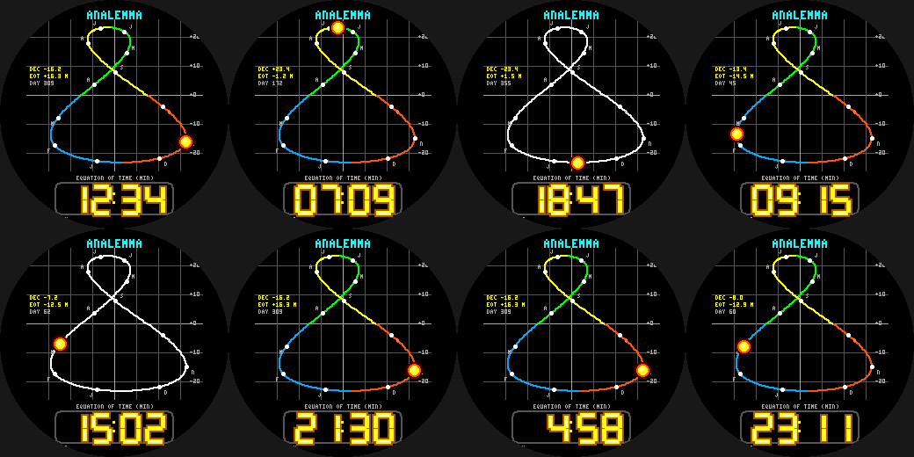

# Analemma

The figure-8 the Sun traces across the sky if you photograph it at the same clock time every day for a year,
on the Pebble Round 2 (`gabbro`). Horizontal = **equation of time** (the Sun runs up to ~16 min ahead of / ~14 min
behind a clock), vertical = **solar declination** (+-23.44 degrees); both from the standard day-of-year
approximations. **Today's position is the glowing Sun** and month starts are marked along the curve.

- Season-coloured curve (winter blue, spring green, summer yellow, autumn orange); graticule every 10 degrees /
  5 minutes. Check: on 5 Nov it reads DEC -15.2, EOT +16.3 min (the real values are about -15.8 / +16.3).
- **Wrist tap:** season colours <-> mono "photographic plate".
- Neon-tube time readout and date. Updates once a minute (cheap on battery).

Build: `pebble build` (uses `../common/face.h`). Previews: `python3 preview.py OUTDIR`.
Status: builds for `gabbro`; passes an AddressSanitizer/UBSan sweep; **not run on the emulator or a real watch**.
