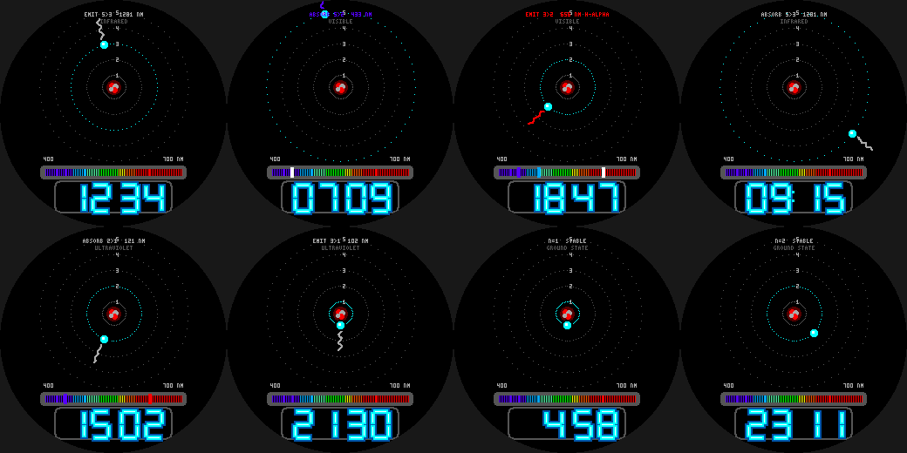

# Bohr Atom

A hydrogen atom on the Pebble Round 2 (`gabbro`). Every second the electron hops to a new energy level and
**emits** (jumping down) or **absorbs** (jumping up) a photon whose wavelength comes from the Rydberg formula,
1/lambda = R (1/nf^2 - 1/ni^2), drawn as a wavy arrow and marked on a 400-700 nm spectrum bar.

- Transitions down to n=2 are the visible **Balmer lines**: H-alpha 656 nm (red), H-beta 486 nm, H-gamma 434 nm,
  H-delta 410 nm. Jumps to n=1 are ultraviolet (e.g. 121 nm) and to n=3 infrared (e.g. 1281 nm), shown in grey.
- Orbital speed falls with n as in the Bohr model; orbit radii are not to scale.
- **Wrist tap:** spectrum bar shows only this second's line, or the last 10 seconds.
- Neon-tube time readout, date.

Build: `pebble build` (uses `../common/face.h`). Previews: `python3 preview.py OUTDIR`.
Status: builds for `gabbro`; passes an AddressSanitizer/UBSan sweep; **not run on the emulator or a real watch**.
