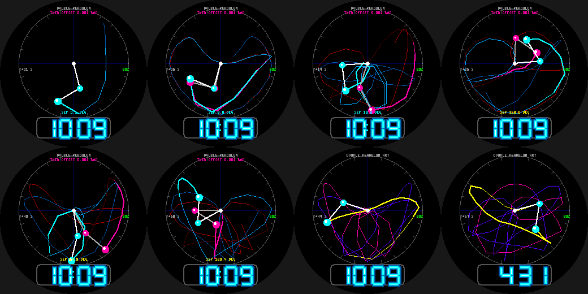

# Chaos Clock

A double pendulum on the Pebble Round 2 (`gabbro`): the textbook demonstration of sensitive dependence
on initial conditions (the butterfly effect).

- **TWIN mode:** two pendulums start from the same minute-seeded state, one nudged by just **0.001 radian**.
  They track each other for a few seconds, then diverge completely; a live readout shows the angular
  separation of the outer arms (wrapped to +-180 degrees). Cyan = original, magenta = nudged twin.
- **ART mode** (wrist tap): a single pendulum with a long glowing rainbow trail.
- The state is a **deterministic function of the clock**: each second the face re-integrates the equations of
  motion (RK4, 20 ms steps, equal masses and lengths) from the top of the minute, recording the tip every
  0.1 s for the trails. Every minute is a different, repeatable trajectory (initial angles depend on the time).
- Protractor ring, neon-tube time readout.

Build: `pebble build` (uses `../common/face.h`). Previews: `python3 preview.py OUTDIR`.
Status: builds for `gabbro`; passes an AddressSanitizer/UBSan sweep; **not run on the emulator or a real
watch**. Each frame integrates up to ~6,000 RK4 steps (two pendulums), which should be a few tens of
milliseconds, but that is unmeasured on real hardware.
