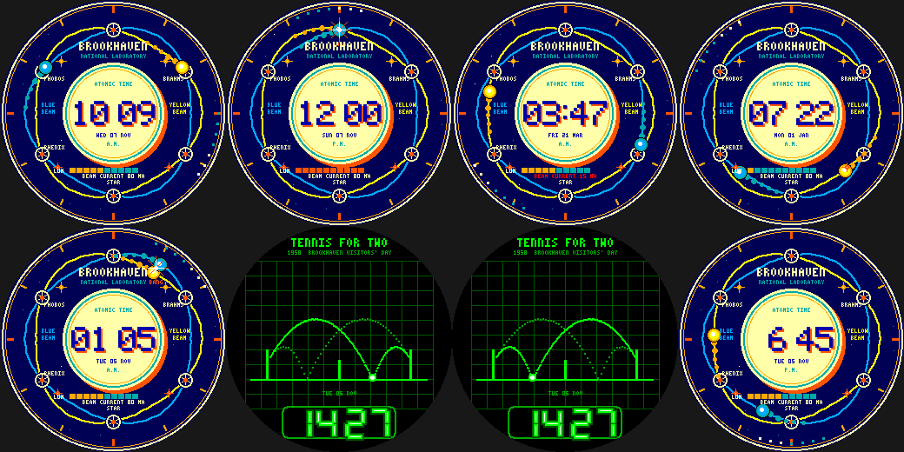

# Collider Clock

A retro-future, Atoms-for-Peace-era watchface for the Pebble Round 2 (`gabbro`), inspired by the Long Island
accelerator laboratory at Brookhaven.

**The dial is a RHIC-style collider.** Two beam rings, BLUE and YELLOW, are drawn as wavy circles that swap
places at six interaction points (12, 2, 4, 6, 8 and 10 o'clock) where small hexagonal detectors sit
(labelled STAR, PHENIX, PHOBOS and BRAHMS from memory of the real RHIC layout - double-check before relying on it).

- **Hour hand** = a bunch of particles on the Blue ring; **minute hand** = a bunch on the Yellow ring. When the two
  meet (11 times in 12 hours: about 12:00, 1:05, 2:10, 3:16, ... 10:54) they **collide** in a starburst marked `BANG`.
- A "proton" races around the bezel once a minute (the second hand).
- Central cream time plate with an orange drop shadow and chunky "atomic age" digits, 12h/24h aware, date and A.M./P.M.
- Steps = **LUMINOSITY** (10-segment bar, orange when the 8,000-step goal is met); battery = **BEAM CURRENT** (mA).
- Palette: deep navy, cream, teal, orange and mustard, plus Googie starbursts.
- The real beams circulate in opposite directions; here both run clockwise so the face stays readable.

**Wrist tap: TENNIS FOR TWO.** A phosphor-green oscilloscope with a graticule, court, net and rackets, replaying
the 1958 Brookhaven visitors'-day game (built by physicist William Higinbotham): each second a parabolic stroke
arcs over the net, bounces and returns, with the previous strokes fading. The time is the scoreboard.

Build: `pebble build` (uses `../common/face.h`). Previews: `python3 preview.py OUTDIR`.
Status: builds for `gabbro`; passes an AddressSanitizer/UBSan sweep; **not run on the emulator or a real watch**.

Store note: this is a fan homage. The face prints the laboratory's name; before publishing, avoid implying official
affiliation or endorsement (and consider a different on-face title), and don't use any official logos.
