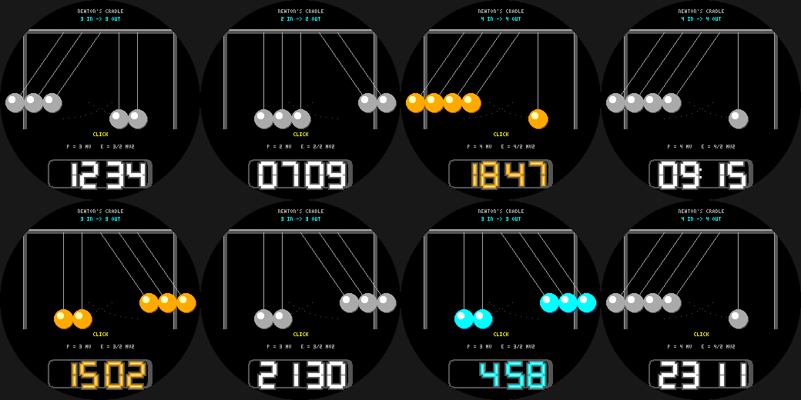

# Newton's Cradle

Conservation of momentum and energy on the Pebble Round 2 (`gabbro`). Five balls; every second the cradle
clicks: **n balls swing out on one side, then n on the other** on the next second. n = (minute mod 4) + 1, so
1 in -> 1 out, 2 in -> 2 out, 3 in -> 3 out, 4 in -> 4 out - exactly what p = mv and E = 1/2 mv^2 demand.

- Balls with highlights and shadows, strings, a frame and dotted swing arcs; `CLICK` flashes on odd seconds.
- **Wrist tap:** steel / brass / neon balls. Neon-tube time readout, date.

Build: `pebble build` (uses `../common/face.h`). Previews: `python3 preview.py OUTDIR`.
Status: builds for `gabbro`; passes an AddressSanitizer/UBSan sweep; **not run on the emulator or a real watch**.
