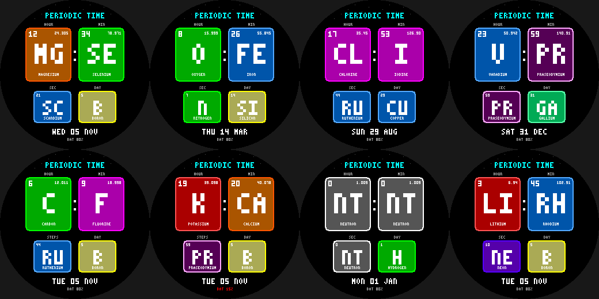

# Periodic Time

A periodic-table watchface for the Pebble Round 2 (`gabbro`). Hour, minute, seconds and day-of-month
are shown as element tiles - atomic number, symbol, name and atomic mass - coloured by element family.
12:34 is **Mg** (24.305) and **Se** (78.971); 23:59 is **V** and **Pr**.

- Elements 0-59 (0 is a "neutron" tile for midnight / zero). Family colours: alkali, alkaline earth,
  transition, post-transition, metalloid, nonmetal, halogen, noble gas, lanthanide.
- **Wrist tap:** replace the seconds tile with a STEPS element: today's steps map onto Z = 0-59 and hit
  praseodymium (59) at the 8,000-step goal.
- 12h/24h follows the watch setting; date and battery along the bottom.

Build: `pebble build` (uses `../common/face.h`). Previews: `python3 preview.py OUTDIR`.
Status: builds for `gabbro`; passes an AddressSanitizer/UBSan sweep; **not run on the emulator or a real watch**.
