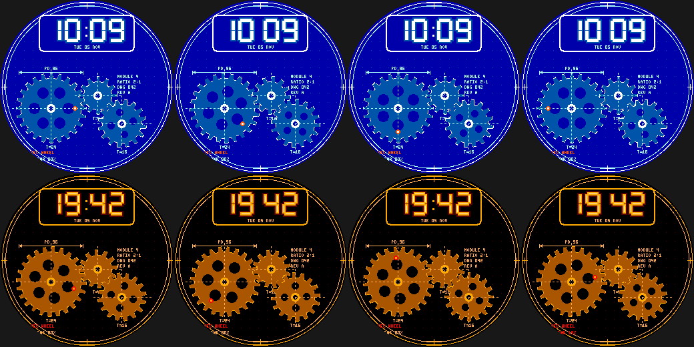

# Gear Train

An engineering-drawing watchface for the Pebble Round 2 (`gabbro`): three meshing spur gears on a
drafting sheet, with the time in a title block.

- Physically consistent mechanism: gear A (24T, module 4) is the **seconds wheel** (once a minute),
  B (12T) meshes with A and turns twice as fast the other way, C (16T) meshes with B. Tooth phasing
  is computed from the line-of-centres angle so the teeth interlock at every second.
- Gears have lightening holes, hubs, dash-dot centre lines and tooth-count labels; a red marker on A's
  rim is the second hand. Dimension callouts (`PD 96`), registration marks and a dotted grid complete
  the drawing.
- **Wrist tap:** BLUEPRINT <-> BRASS (steampunk) palettes.

Build: `pebble build` (uses `../common/face.h`). Previews: `python3 preview.py OUTDIR`.
Status: builds for `gabbro`; passes an AddressSanitizer/UBSan sweep; **not run on the emulator or a real watch**.
