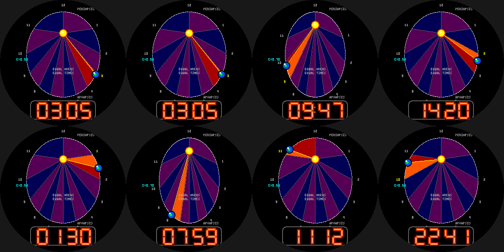

# Kepler Clock

A watchface where **the hour hand is a planet on a real Keplerian orbit** (Pebble Round 2, `gabbro`).

- The planet's 12-hour period is solved from **Kepler's equation** (E - e sin E = M, Newton's method), so it
  sweeps past the Sun at periapsis (12 o'clock) and crawls at apoapsis (6 o'clock) - yet is exactly on the
  numbered hour mark at each full hour.
- The 12 wedges between hour marks all have **equal area** (Kepler's second law); the area swept so far this
  hour is shaded orange. The radius vector (yellow) is the "hand".
- **Wrist tap:** eccentricity 0.5 <-> 0.7 for a more dramatic ellipse.
- Neon-tube time readout underneath.

Build: `pebble build` (uses `../common/face.h`). Previews: `python3 preview.py OUTDIR`.
Status: builds for `gabbro`; passes an AddressSanitizer/UBSan sweep; **not run on the emulator or a real watch**.
