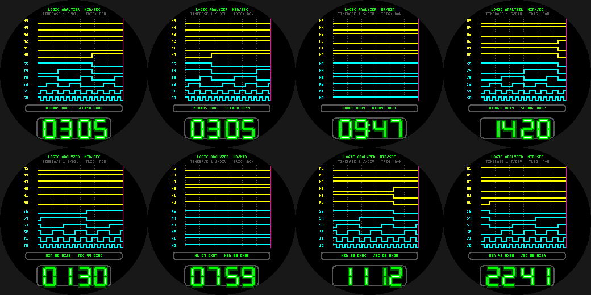

# Logic Analyzer

The time as a logic-analyzer capture on the Pebble Round 2 (`gabbro`): 12 digital channels showing the bits of
the **minute** (yellow) and **second** (cyan) counters over the last 30 seconds, a magenta `NOW` cursor, and
decoded bus values in decimal and hex (`MIN=05 0x05  SEC=10 0x0A`).

- Watch bit 0 toggle every second, bit 1 every two, bit 2 every four... a binary counter on your wrist.
- **Wrist tap:** show the HOUR/MIN counters instead of MIN/SEC.
- Dotted time grid (1 s/div), neon-tube time readout, battery.

Build: `pebble build` (uses `../common/face.h`). Previews: `python3 preview.py OUTDIR`.
Status: builds for `gabbro`; passes an AddressSanitizer/UBSan sweep; **not run on the emulator or a real watch**.
