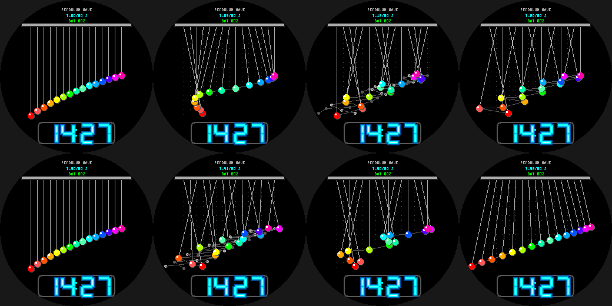

# Pendulum Wave

The classic physics demonstration as a Pebble Round 2 (`gabbro`) watchface: **15 pendulums** whose
lengths are tuned so pendulum *i* makes (40 + i) swings in exactly 60 seconds (T^2 ~ L, so lengths
fall as the square of the swing count). They start in a line at :00, ripple into travelling waves,
snakes and standing patterns, and realign at the next :00 (and again at :30). The seconds are the
phase of the system.

- Rainbow bobs on strings from a support bar, a thin line joining the bobs to show the wave.
- Neon-tube time readout and a `T=SS/60 S` cycle counter.
- **Wrist tap:** ghost positions from the previous two seconds (motion trails).

Build: `pebble build` (uses `../common/face.h`). Previews: `python3 preview.py OUTDIR`.
Status: builds for `gabbro`; passes an AddressSanitizer/UBSan sweep; **not run on the emulator or a real watch**.
