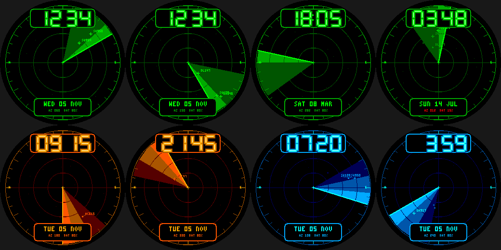

# Radar

An air-traffic-control radar scope for the Pebble Round 2 (`gabbro`).

- The **sweep arm** turns once a minute (6 degrees per second) with a fading phosphor wedge behind it.
- 14 **targets** drift slowly in range and azimuth through the day. They light up when the sweep crosses
  them, then fade over about 66 degrees of sweep; freshly painted ones show a cross and a callsign tag
  (e.g. `UA482`).
- Range rings, cross-hairs, azimuth ticks every 10 degrees, own-ship marker, neon-tube time plate on top,
  date / sweep azimuth / battery plate below.
- **Wrist tap:** green / amber / ice-blue phosphor.

Build: `pebble build` (uses `../common/face.h`). Previews: `python3 preview.py OUTDIR`.
Status: builds for `gabbro`; passes an AddressSanitizer/UBSan sweep; **not run on the emulator or a real watch**.
