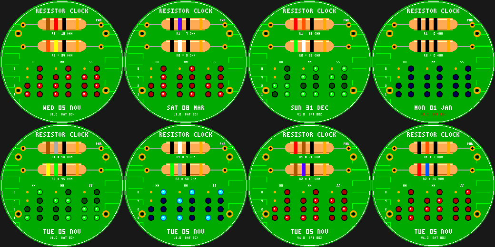

# Resistor Clock

An electronics watchface for the Pebble Round 2 (`gabbro`): a green PCB where the **hour and minute are
resistor values in the standard colour code** and an **LED matrix shows HH:MM:SS in binary-coded decimal**.

- R1 = hour, R2 = minute: bands are tens digit, ones digit, x1 multiplier (black) and a gold tolerance band
  (0 black, 1 brown, 2 red, 3 orange, 4 yellow, 5 green, 6 blue, 7 violet, 8 gray, 9 white). 12 ohm is
  brown-red-black; 34 ohm is orange-yellow-black.
- BCD matrix: columns of 8-4-2-1 LEDs for each decimal digit of HH, MM and SS (unused high bits are bare pads).
- Silkscreen date and battery, gold pads, vias, mounting holes, copper traces and a blinking power LED.
- **Wrist tap:** LED colour (red / green / cyan).

Build: `pebble build` (uses `../common/face.h`). Previews: `python3 preview.py OUTDIR`.
Status: builds for `gabbro`; passes an AddressSanitizer/UBSan sweep; **not run on the emulator or a real watch**.
