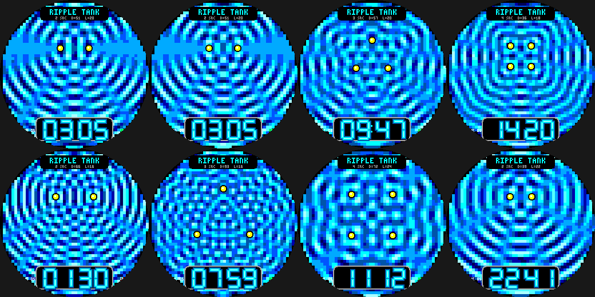

# Ripple Tank

Wave interference on the Pebble Round 2 (`gabbro`): the sum of waves cos(kr - wt) from 2, 3 or 4 point
sources, painted as a ripple-tank water surface (bright crests, dark troughs, and the still nodal lines where
waves cancel).

- Source spacing follows the **minutes** and wavelength follows the **hour**, so the pattern changes every
  few minutes; the wave phase advances 60 degrees per second.
- With two sources a half-integer d/lambda cancels the waves along the line through them (a flat band) -
  real physics, not a glitch.
- **Wrist tap:** 2 / 3 / 4 sources. Neon-tube time plate, date and battery.

Build: `pebble build` (uses `../common/face.h`). Previews: `python3 preview.py OUTDIR`.
Status: builds for `gabbro`; passes an AddressSanitizer/UBSan sweep; **not run on the emulator or a real watch**.
Each frame paints ~2,000 5x5 cells once a second (cost unmeasured on hardware).
