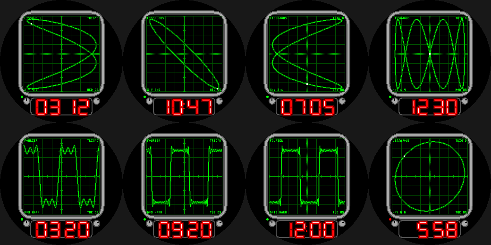

# Oscilloscope

A phosphor-CRT oscilloscope watchface for the Pebble Round 2 (`gabbro`).

- **LISSAJOUS mode:** the trace is a Lissajous figure with X:Y frequency ratio = (hour mod 6 + 1) :
  (minute/10 + 1); its phase sweeps every second and a white "beam spot" rides the trace.
- **FOURIER mode** (wrist tap): a square wave built from as many odd harmonics as the hour
  (12 at noon), drawn over the ideal square wave so you can see the Gibbs overshoot.
- Graticule with minor ticks, on-screen readouts (`TRIG'D` blinks), red LED time readout, knobs and a
  power LED that turns red on low battery.

Build: `pebble build` (uses `../common/face.h`). Previews: `python3 preview.py OUTDIR`.
Status: builds for `gabbro`; passes an AddressSanitizer/UBSan sweep; **not run on the emulator or a real
watch**. The trace redraws a few hundred line segments once a second.
