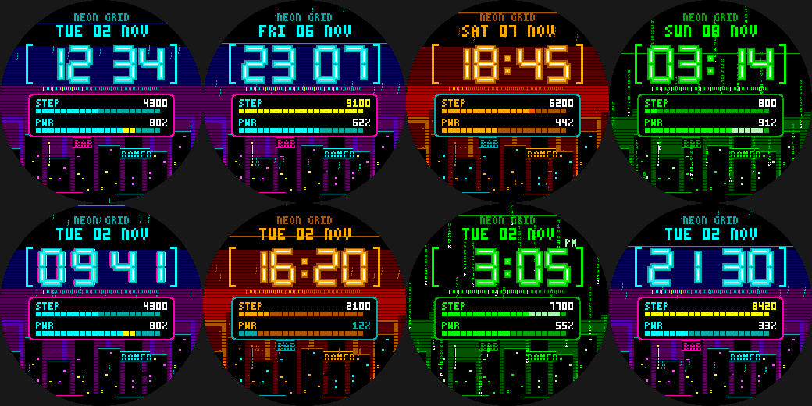

# Neon Grid

A cyberpunk watchface for the Pebble Round 2 (`gabbro`, 260x260 round colour).



- **Neon-tube time**: chamfered 7-segment digits drawn as a glow halo, a coloured tube and a white-hot
  core, with a blinking colon. Every so often (and at the top of each minute) it glitches: RGB-split
  ghosts and one digit slips sideways.
- **Rain-soaked neon skyline** under a glowing horizon: flickering windows and billboards
  (`BAR`, `RAMEN`, a hotel sign), falling rain, hover-cars that slip between the towers and a slow scanning bar. The MATRIX theme
  swaps the rain for falling columns of green code.
- **HUD plate** with segmented bars for today's steps (goal 8,000; turns gold when reached) and
  battery (blinks when low), plus the date and a 60-tick seconds ruler.
- **Three themes** - NEON (cyan/magenta), BLADE (amber/teal) and MATRIX (green). **Flick your wrist
  to cycle themes**; the choice is saved.
- 12h/24h follows the watch setting. Animates once a second only while visible and above 15%
  battery, otherwise once a minute.
- Everything is drawn with rectangles: no assets, and no system fonts, so the previews below match
  the watch exactly.

Previews (rows: neon day/night, blade, matrix, glitch burst, low battery, 12h with PM, goal reached):
see `docs/preview.png`. Render them yourself with `python3 tools/preview/render.py OUTDIR`
(needs gcc + Pillow).

## Build

```sh
pebble build
pebble install --emulator gabbro
```

Needs the `health` capability (declared in `package.json`) for the step bar.

## Status

`pebble build` succeeds for `gabbro` (SDK 4.33.1, 6 KB RAM) and the drawing code passes an
AddressSanitizer/UBSan sweep (2,500+ random states, re-run after the neon-tube redesign). It has **not** been run on the emulator or a
real watch.
